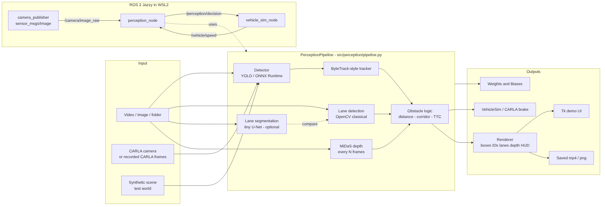

# AIML-04 - Autonomous Driving Perception Stack

A modular autonomous-driving perception prototype for road-object detection and tracking, classical OpenCV lane detection, approximate depth estimation, and obstacle-response simulation. It includes experimental interfaces for segmentation, MiDaS, ROS 2 and CARLA; see the validation report for which components were actually tested. Designed for a CPU-only Windows 11 laptop (Ryzen 5 7530U, 16 GB), with ROS 2 Jazzy in WSL2.

> **Start with [docs/LOCAL_VALIDATION.md](docs/LOCAL_VALIDATION.md)** for the actual local test results and limitations. This project has been tested on Windows 11 with Python 3.12 and WSL2 Ubuntu 24.04 / ROS 2 Jazzy. Pretrained YOLO11n inference, ONNX export and CPU benchmarking, and a ROS 2 pipeline using recorded synthetic video were tested locally. Fine-tuning, MiDaS inference, trained lane segmentation, CARLA integration, TensorRT and online W&B logging remain unverified. Synthetic tests are not evidence of real-road accuracy or safety.



## What runs immediately (core install only, no downloads)
Synthetic demo video, ground-truth test detector, tracking, classical OpenCV lanes, obstacle logic, closed-loop braking scenarios, dataset-analysis demo and test suite. The ground-truth detector is a test double, not a neural network.

## What has been tested with the ML install
- Pretrained YOLO11n detection on the supplied real bus image.
- ONNX export, structural validation and ONNX Runtime CPU inference.
- PyTorch CPU vs ONNX Runtime CPU benchmark (see `docs/LOCAL_VALIDATION.md`).
- ONNX pipeline execution on the supplied bus image.

MiDaS depth inference and trained lane-segmentation inference remain unverified.

## Needs cloud GPU
TensorRT (`notebooks/01_tensorrt_benchmark_colab.ipynb`), practical fine-tuning (`notebooks/02_finetune_yolo_colab.ipynb`).
## Needs CARLA hardware
`scripts/carla_*.py`, `carla_demo.launch.py` (see `docs/ROS2_CARLA.md` for the alternative with recorded frames).

---
## 1. Get the project (Windows)
1. Extract the ZIP **over/into** `C:\Users\vatsa\Projects\AIML-04-Autonomous-Driving` (your existing folder and git repo are kept; the ZIP's folders match yours plus a few additions). If you extract elsewhere, change `PROJECT_WIN` in `scripts/ros2_*.sh`.
2. Open VS Code: `code C:\Users\vatsa\Projects\AIML-04-Autonomous-Driving` (PowerShell).

## 2. Python environment (PowerShell, in the project folder, VS Code terminal)
```powershell
cd C:\Users\vatsa\Projects\AIML-04-Autonomous-Driving
python -m venv .venv
.\.venv\Scripts\Activate.ps1          # if blocked: Set-ExecutionPolicy -Scope CurrentUser RemoteSigned
python -m pip install --upgrade pip
pip install -r requirements.txt       # CORE
python main.py check                  # shows what is installed
```
In VS Code choose the interpreter `.venv` (Ctrl+Shift+P -> "Python: Select Interpreter").

## 3. First run - no downloads needed
```powershell
python scripts/make_demo_data.py                                   # synthetic video, GT, mini datasets (~6 MB, 10 s)
python -m pytest -q                                                # run the tests
python scripts/run_pipeline.py --source datasets/samples/synthetic_drive.mp4 --detector groundtruth --no-depth
python scripts/run_closed_loop_demo.py --scenario stopped --panel mosaic    # obstacle-reaction demo + video + plot
python scripts/analyze_dataset.py --demo                           # dataset analysis script on FAKE labels
python scripts/compare_lanes.py --synthetic 40                     # lane evaluation on synthetic frames
```
Outputs: `outputs/videos/*.mp4`, `outputs/metrics/*.json|csv|md`, `outputs/visualizations/*.png`.
(The ZIP already contains one pre-generated run of the closed-loop demo so you can look at it right away.)

## 4. Real models (ML install)
```powershell
pip install torch torchvision --index-url https://download.pytorch.org/whl/cpu
pip install -r requirements-ml.txt
python scripts/download_weights.py                  # yolo11n.pt -> models/detection/
python scripts/download_samples.py                  # one real street photo (bus.jpg)
python main.py check
python scripts/run_pipeline.py --source datasets/samples/bus.jpg          # YOLO + tracker + lanes + MiDaS (MiDaS downloads on first use)
python scripts/run_pipeline.py --source path\to\your_dashcam.mp4 --max-frames 200
```
If MiDaS cannot be loaded the pipeline continues without depth and prints a warning. Python 3.12 + torch CPU wheels are supported by current PyTorch; if `pip` cannot find a wheel, tell your supervisor/AI the exact error rather than switching versions blindly.

## 5. Demo interface
```powershell
python main.py gui
```
Open image/video -> choose detector (`yolo` after step 4; `groundtruth` only for the synthetic video) -> Run -> tabs *Combined / Detections / Lanes / Depth / All four*. "Save output" writes to `outputs/videos/` (or PNGs for images). Tk is included in the python.org installer; if `tkinter` is missing re-run the installer and tick "tcl/tk".

## 6. Dataset exploration, fine-tuning
See [docs/DATASETS.md](docs/DATASETS.md). Short version:
```powershell
python scripts/analyze_dataset.py --dataset bdd100k --labels datasets/raw/bdd100k/labels/det_20/det_train.json
python scripts/prepare_dataset.py --dataset bdd100k --labels <det_train.json> --images <images/100k/train> --max-images 3000
python scripts/train_detector.py --data datasets/processed/bdd100k_yolo/data.yaml --smoke        # plumbing check (1 epoch)
```
Real training: use `notebooks/02_finetune_yolo_colab.ipynb`, then copy `best.pt` to `models/detection/` and set `detector.weights`. **You may only say "fine-tuned" after this has actually run.**

## 7. W&B (optional)
```powershell
$env:WANDB_API_KEY = "<your key>"      # per terminal session; never put it in a file or commit it
python scripts/run_closed_loop_demo.py --scenario stopped --wandb
python scripts/train_detector.py --data ... --wandb
```
Without a key it automatically switches to offline mode (`wandb sync` later).

## 8. ONNX (CPU) and TensorRT (cloud)
```powershell
python scripts/export_onnx.py               # yolo11n.pt -> yolo11n.onnx + validation
python scripts/benchmark_inference.py       # PyTorch vs ONNX Runtime on YOUR laptop -> docs/BENCHMARK_REPORT_generated.md
python scripts/run_pipeline.py --source <video> --detector onnx
```
TensorRT: upload `notebooks/01_tensorrt_benchmark_colab.ipynb` to Google Colab (T4 GPU) or Kaggle and run all cells; copy `benchmark_gpu.json` back. ONNX numbers (your CPU) and TensorRT numbers (cloud GPU) are different experiments - see `docs/BENCHMARK_REPORT.md`.

## 9. ROS 2 in Ubuntu WSL2
Use the **Ubuntu terminal** (not PowerShell):
```bash
cd /mnt/c/Users/vatsa/Projects/AIML-04-Autonomous-Driving
bash scripts/ros2_setup_wsl.sh          # once
bash scripts/ros2_run_demo.sh           # terminal 1
bash scripts/ros2_smoke_test.sh         # terminal 2
```
Details, troubleshooting and the CARLA options: [docs/ROS2_CARLA.md](docs/ROS2_CARLA.md).

## 10. Tests
Latest local result in the Windows Python 3.12 environment:

```powershell
python -m pytest -q
# 73 passed, 4 skipped, 1 warning
```

The ROS 2 Jazzy package was built and its camera-to-perception-to-vehicle topic flow was smoke-tested in WSL2 using recorded synthetic video. See `docs/LOCAL_VALIDATION.md` for details and limitations.

## 11. Configuration
`configs/default.yaml` (everything), `configs/ros2.yaml`, `configs/carla.yaml`, `configs/train.yaml`. Override any value: `--set detector.conf=0.3 obstacle.brake_distance=18`.

## Known limitations
- Distances are approximate (bounding-box height and assumed object size/FOV); calibrate `obstacle.camera.hfov_deg`.
- MiDaS depth is relative, not metric; real MiDaS inference has not been verified in this project run.
- Classical lane detection fits straight lines and can struggle with curves, shadows and night conditions. The U-Net has no verified trained weights.
- The tracker is a custom ByteTrack-style implementation; no formal MOT metrics are included.
- Obstacle thresholds were tuned on synthetic scenarios only. Closed-loop braking demos are simulations, not real-road safety validation.
- YOLO was tested using pretrained weights on a sample image; this is not fine-tuning or an accuracy evaluation.
- ONNX Runtime CPU optimization showed only a modest latency difference on the tested machine. No TensorRT benchmark was performed.
- ROS 2 Jazzy nodes were built and tested locally using recorded synthetic video. This is not a live CARLA integration.
- W&B online logging and real-world perception accuracy remain unverified.
- See `docs/LOCAL_VALIDATION.md` for the tested configuration and remaining limitations.

## Deliverables map
README (this) - `docs/ARCHITECTURE.md` + `docs/architecture.png` - `docs/MODULES.md` - `docs/DATASETS.md` - `docs/API.md` - `docs/TESTING.md` - `docs/BENCHMARK_REPORT.md` - `docs/LOCAL_VALIDATION.md` - `docs/DEMO_RECORDING.md` - `docs/GIT_WORKFLOW.md` - `docs/PRESENTATION.md` - `docs/REFLECTION_TEMPLATE.md` - `docs/STATUS.md`.

## First-run checklist
- [x] Core dependencies installed and `python main.py check` verified.
- [x] Test suite: 73 passed, 4 skipped.
- [x] Synthetic video pipeline and closed-loop scenarios executed.
- [x] Pretrained YOLO11n inference tested on `datasets/samples/bus.jpg`.
- [x] ONNX export, validation, inference and CPU benchmark completed.
- [x] ROS 2 Jazzy package built; local topics and messages smoke-tested in WSL2.
- [ ] Fine-tune YOLO on a real dataset and evaluate on a held-out test set.
- [ ] Verify MiDaS depth inference and trained lane segmentation.
- [ ] Run CARLA integration and TensorRT benchmark on compatible hardware.
- [ ] Verify W&B online logging.
- [ ] Review `docs/LOCAL_VALIDATION.md`, finish the presentation and reflection, and commit the project.
