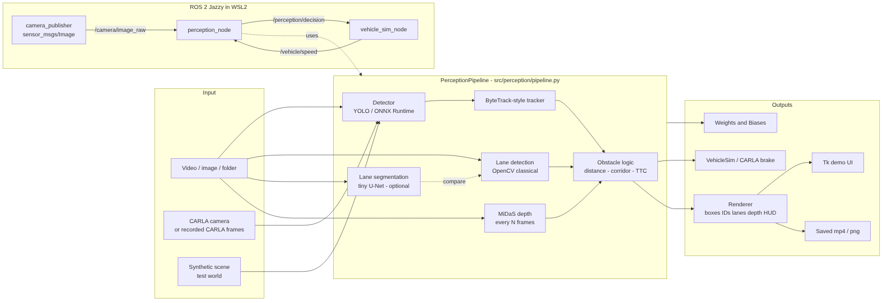

# Architecture

  (source: `architecture.mmd`)

## Data flow per frame (`PerceptionPipeline.process`)
1. **Detect** - `YoloDetector` (PyTorch) or `OnnxDetector` (ONNX Runtime) or the ground-truth test double -> `Detection` list. Low confidence threshold (0.15) on purpose: the tracker uses low-score boxes.
2. **Track** - `ByteTracker` (Kalman + IoU Hungarian, two-stage association) -> `Track` objects with stable IDs.
3. **Lanes** - `ClassicalLaneDetector` (colour+Canny, ROI, Hough, least-squares ego-lane lines, temporal smoothing). Optionally `SegLaneDetector` (U-Net) for the comparison panel.
4. **Depth** - `MidasDepth` every `depth.interval` frames (cached in between) -> relative proximity map; each track gets the median proximity in the lower half of its box.
5. **Obstacle logic** - `ObstacleController`: approximate distance (pinhole model, class heights), ego corridor (fitted lane lines extended to the horizon, else a configured trapezoid), time-to-collision from the distance history, state machine CLEAR / CAUTION / BRAKE with release hysteresis.
6. **Vehicle response** - `VehicleSim` (point mass) or CARLA control or the ROS 2 `vehicle_sim_node` turn the decision into speed.
7. **Render** - `render_panels` draws the four panels used by the GUI, CLI video output and ROS annotated topic.

## Why metric distance does not come from MiDaS
MiDaS gives relative inverse depth with unknown scale per frame. Distances in the HUD come from box height + assumed object height + assumed camera FOV, so they are **approximate** and need calibration (`obstacle.camera.hfov_deg`). MiDaS is shown as a depth map and as a per-object "relative proximity" cue.

## Folder layout (changes vs. your starting structure)
Kept all your folders. Added: `src/app` (GUI + shared session), `models/lane_seg`, `ros2_ws/` (ROS 2 package), `main.py`, `requirements*.txt`, `pytest.ini`, plus `docs/` content. `src/utils`, `src/data`, ... as you created.

## ROS 2 topics
| topic | type | publisher -> subscriber |
|---|---|---|
| `/camera/image_raw` | sensor_msgs/Image (bgr8) | camera_publisher (or carla_bridge) -> perception_node |
| `/perception/annotated` | sensor_msgs/Image | perception_node -> (rqt_image_view) |
| `/perception/tracks` | std_msgs/String (JSON) | perception_node |
| `/perception/decision` | std_msgs/String (JSON) | perception_node -> vehicle_sim_node / carla_bridge |
| `/vehicle/speed` | std_msgs/Float32 | vehicle_sim_node -> perception_node |
| `/cmd_vel` | geometry_msgs/Twist | vehicle_sim_node |

JSON-in-String was chosen to avoid building custom message packages in a 4-5 day project. `cv_bridge` is deliberately **not** used (see `src/utils/ros_image.py`): the apt cv_bridge is built against NumPy 1.x and can crash with NumPy 2 wheels.
